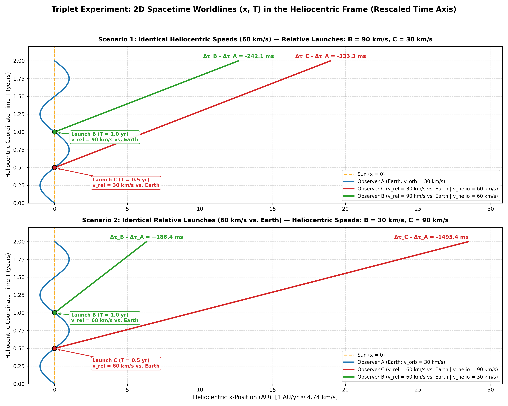

# Triplet Experiment Simulation

This project simulates the kinematics and resulting relativistic effects of three observers (A, B, and C) traveling through the solar system. Moving beyond classical relative velocity comparisons, this simulation resolves the "Twin Paradox" by integrating the proper time ($\tau$) of each observer relative to a single, overarching reference frame: the solar system's heliocentric coordinate time ($T$).

> **Key Question:** *If two travelers launch from Earth with identical relative velocities and accelerations—one six months after the other—why do their atomic clocks diverge dramatically, and how can one of them actually age **faster** than the observer who stayed on Earth?*

## Table of Contents

* [The Classic Twin Paradox Perception](#the-classic-twin-paradox-perception)

* [The Heliocentric Frame & Proper Time Integration](#the-heliocentric-frame--proper-time-integration)

* [Resolving the Twin Paradox: The Scenarios](#resolving-the-twin-paradox-the-scenarios)

* [The Physics & Simulation Parameters](#the-physics--simulation-parameters)

* [The Equatorial Thought Experiment & The ECI Frame](#the-equatorial-thought-experiment--the-eci-frame)

* [The Heliocentric Contradiction & Its Resolution](#the-heliocentric-contradiction--its-resolution)

* [Real-World Application: The GPS Satellite Network](#real-world-application-the-gps-satellite-network)

* [The Michelson-Morley Experiment & Frame Invariance](#the-michelson-morley-experiment--frame-invariance)

* [The Kennedy-Thorndike Experiment: Combining Length Contraction and Time Dilation](#the-kennedy-thorndike-experiment-combining-length-contraction-and-time-dilation)

* [The Michelson-Gale Experiment & The Sagnac Effect](#the-michelson-gale-experiment--the-sagnac-effect)

* [Stellar Aberration & The Limits of Local Inertial Frames](#stellar-aberration--the-limits-of-local-inertial-frames)

* [Atmospheric Muon Decay & The Co-Moving Observer Trap](#atmospheric-muon-decay--the-co-moving-observer-trap)

* [Activate the Environment](#activate-the-environment)

* [Run the Simulations](#run-the-simulations)

* [References](#references)

## The Classic Twin Paradox Perception

In the standard textbook formulation of the "Twin Paradox," time dilation is usually framed purely in terms of the velocity relative to Earth. To resolve the paradox, explaining why the traveling twin ages less rather than the other way around, the classic explanation relies on acceleration. We are taught that because only the traveling twin undergoes acceleration (departing, turning around, and stopping), the symmetry between the two observers is broken.

While this heuristic works for simple scenarios, it masks the true mechanics of relativity when launching from a platform that is already moving, such as the Earth orbiting the Sun. This simulation replaces the twin scenario with a Triplet Experiment to demonstrate why the classic focus on relative velocity and acceleration is incomplete.

## The Heliocentric Frame & Proper Time Integration

Instead of calculating time dilation purely based on relative velocities between the observers (which ignores the non-inertial nature of Earth as a launch platform), this model evaluates each observer's exact trajectory through the Sun's gravitational well.

At every time step, the simulation calculates the fractional clock rate difference by combining:

1. **Gravitational Time Dilation:** $\frac{\Phi_{sun}(R(T))}{c^2}$ — Clocks tick slower deeper in the Sun's gravitational well.

2. **Kinematic Time Dilation:** $-\frac{V(T)^2}{2c^2}$ — Clocks tick slower the faster they move relative to the solar system's rest frame.

The total elapsed proper time ($\Delta\tau$) is the cumulative integral of these local Lorentz and gravitational transformations over the coordinate time $T$.

## Resolving the Twin Paradox: The Scenarios

A fundamental premise of this model is demonstrating how Earth's own orbital velocity ($\approx 30\text{ km/s}$) breaks the symmetry of the Twin Paradox. To illustrate this, the project provides two distinct scenarios:

### Scenario 1: Identical Heliocentric Velocities (30/90 km/s relative launches)

In this scenario, we want both traveling observers (B and C) to travel at exactly $60\text{ km/s}$ relative to the Sun.

* **Observer B** departs after 1 full orbit (when Earth is moving at $-30\text{ km/s}$ on the x-axis). To reach a heliocentric speed of $+60\text{ km/s}$, B must be launched at $90\text{ km/s}$ **relative to Earth**.

* **Observer C** departs after 0.5 orbits (when Earth is moving at $+30\text{ km/s}$ on the x-axis). To reach a heliocentric speed of $+60\text{ km/s}$, C only needs to be launched at $30\text{ km/s}$ **relative to Earth**.


### Scenario 2: Identical Relative Launch Velocities (60/60 km/s relative to Earth)

In this complementary scenario, both observers are launched at exactly $60\text{ km/s}$ **relative to Earth**.

* **Observer B (Downstream Launch):** Departs at $t=1$ year. Because Earth is moving at $-30\text{ km/s}$, Observer B's absolute heliocentric velocity is drastically reduced to $30\text{ km/s}$. B suffers the same kinematic penalty as Earth, but because B travels further from the Sun (reducing the gravitational penalty), B's clock actually ends up ticking *faster* than Earth's.

* **Observer C (Upstream Launch):** Departs at $t=0.5$ years. Because Earth is moving at $+30\text{ km/s}$ at this moment, the velocities add up vectorially. Observer C achieves an absolute heliocentric velocity of $90\text{ km/s}$, resulting in a massive kinematic time dilation spike.


### Spacetime Worldlines: Visualizing the Trajectories

To compare both scenarios directly in spacetime, the figure below plots the 2D heliocentric worldlines $(x, T)$ of all three observers with the time axis rescaled from light-years ($cT$) to years ($T$) for visual clarity. In this projection, Earth's circular orbit appears as a sinusoidal oscillation ($x \in [-1, +1]\text{ AU}$) around the Sun ($x = 0$), while the slope $\frac{dx}{dT} = v_x$ directly represents each traveler's heliocentric velocity ($1\text{ AU/yr} \approx 4.74\text{ km/s}$):



* **Scenario 1 (Top Panel — $30/90\text{ km/s}$ relative launches):** After departure, Observers B and C follow **parallel** worldlines at $v_{\text{helio}} = 60\text{ km/s}$. At $T = 2.0\text{ yr}$, their accumulated proper time offsets relative to Earth are $\Delta\tau_B - \Delta\tau_A = -242.1\text{ ms}$ and $\Delta\tau_C - \Delta\tau_A = -333.3\text{ ms}$, driven by the six-month head start C has in climbing out of the Sun's gravitational well.

* **Scenario 2 (Bottom Panel — $60/60\text{ km/s}$ relative launches):** Observer B's downstream launch produces a shallow slope ($v_{\text{helio}} = 30\text{ km/s}$, matching Earth's orbital speed), allowing B to age *faster* than Earth ($\Delta\tau_B - \Delta\tau_A = +186.4\text{ ms}$ at $T = 2.0\text{ yr}$), whereas Observer C's upstream launch yields a steep slope ($v_{\text{helio}} = 90\text{ km/s}$) and a cumulative lag of $\Delta\tau_C - \Delta\tau_A = -1495.4\text{ ms}$.

## The Physics & Simulation Parameters

The simulation is set up with the following parameters:

* **The Sun** is stationary at the origin $(x=0, y=0)$.

* **Observer A (Earth)** starts at $x=0, y=1\text{ AU}$ and travels in a counter-clockwise circular orbit. Observer A serves as our baseline clock, experiencing a constant gravitational and kinematic time dilation penalty relative to the solar system.

### The Proper Time Calculation

For any point in space, an observer is at a heliocentric distance $R(T) = \sqrt{x(T)^2 + y(T)^2}$ with a heliocentric velocity $V(T) = \sqrt{v_x(T)^2 + v_y(T)^2}$.

The rate of proper time $\tau$ relative to coordinate time $T$ is:

$$
\frac{d\tau}{dT} = 1 + \frac{\Phi_{sun}(R(T))}{c^2} - \frac{V(T)^2}{2c^2}
$$

Where $\Phi_{sun}(R) = -\frac{G M_{sun}}{R}$. The script integrates this dynamically over the entire journey to find the exact accumulated time dilation relative to Earth ($\Delta\tau_{obs} - \Delta\tau_{Earth}$).

## The Equatorial Thought Experiment & The ECI Frame

To fully understand how local inertial frames govern time dilation, we can look at a classic thought experiment on Earth's equator involving two observers:

* **Observer A (The Plane):** Flies due West along the equator at approximately $465\text{ m/s}$, matching the rotational speed of the Earth so that the Sun remains perfectly overhead.

* **Observer B (The Balloon):** Floats in a tethered balloon at the exact same altitude, simply rotating along with the Earth.

To evaluate their time dilation, we must use the **Earth-Centered Inertial (ECI) frame**. The ECI is a non-rotating reference frame that moves through space alongside the Earth. In this frame, the Earth rotates beneath the coordinate system.

From the ECI perspective, the kinematic reality becomes clear: **Observer A** is completely stationary ($v_A \approx 0\text{ m/s}$), while **Observer B** in the balloon is hurtling eastward through space at $v_B \approx 465\text{ m/s}$. Because Observer A is at rest relative to the local inertial frame, A suffers no kinematic time dilation penalty. Observer B, however, is moving relative to the ECI and therefore experiences a constant time dilation penalty. After a 24-hour period, Observer A's clock will have advanced faster, leading Observer B's clock by approximately $104\text{ nanoseconds}$. Time dilation is driven by speed relative to the local non-rotating inertial frame, not speed relative to the ground.

## The Heliocentric Contradiction & Its Resolution

When we shift our perspective from the regional ECI frame to the overarching Heliocentric frame, an apparent contradiction emerges regarding Observer B (the balloon):

* **In the ECI Frame:** The balloon travels at a constant, static speed of $465\text{ m/s}$. Its kinematic time dilation is constant.

* **In the Heliocentric Frame:** The Earth is orbiting the Sun at $\sim 30\text{ km/s}$. As the Earth rotates, the balloon's absolute heliocentric velocity oscillates. On the midnight side, the balloon's rotational velocity adds to Earth's orbital velocity ($30\text{ km/s} + 465\text{ m/s}$). On the noon side, it subtracts ($30\text{ km/s} - 465\text{ m/s}$).

If kinematic time dilation oscillates in the heliocentric frame, how can the balloon's clock rate remain constant relative to the center of the Earth?

The resolution lies in General Relativity and the full proper time equation: 

$$
\frac{d\tau}{dT} = 1 + \frac{\Phi_{sun}}{c^2} - \frac{V^2}{2c^2}
$$

Expanding the squared heliocentric speed 

$$
V^2 = (\vec{v}_{Earth} + \vec{v}_{rot})^2
$$

reveals a kinematic cross-term, 

$$
-\frac{\vec{v}_{Earth} \cdot \vec{v}_{rot}}{c^2}
$$

which oscillates between Solar Noon and Midnight:

* **At Solar Noon:** The balloon moves opposite to Earth's orbital motion ($V \approx 30\text{ km/s} - 465\text{ m/s}$), temporarily reducing its kinematic penalty relative to Earth's center.

* **At Midnight:** The balloon moves in the same direction as Earth's orbit ($V \approx 30\text{ km/s} + 465\text{ m/s}$), temporarily increasing its kinematic penalty.

Over a full 24-hour rotation, this cross-term naturally averages to zero ($\oint \cos\theta\,d\theta = 0$). Meanwhile, although the direct difference in the Sun's gravitational potential $\Phi_{sun}$ across Earth's radius is tiny (an amplitude of only $\sim 5.9\text{ ns}$), the **gradient** of $\Phi_{sun}$ matches Earth's exact orbital acceleration ($\vec{a}_{Earth} = -\nabla\Phi_{sun}$). By Einstein's Equivalence Principle, this free-fall acceleration cancels the Sun's gravitational pull inside the local ECI frame.

### The Relativity of Simultaneity & Position Integrity

While the daily oscillation averages out over a full rotation, integrating the kinematic cross-term 

$$
-\frac{\vec{v}_{Earth} \cdot \vec{v}_{rot}}{c^2}
$$ 

over time leaves a periodic daily swing of $\pm 2.1\ \mu\text{s}$ in the heliocentric coordinate time comparison.

Why doesn't this $2.1\ \mu\text{s}$ time fluctuation result in a physical position difference (a spatial displacement) for the balloon?

This oscillation is the exact manifestation of the **Relativity of Simultaneity** phase shift ($\frac{vx}{c^2}$) from the Lorentz transformation. With Earth's orbital velocity ($v \approx 30,000\text{ m/s}$) and radius ($x \approx 6,378,000\text{ m}$), the phase shift is exactly $\frac{(30,000)(6,378,000)}{c^2} \approx 2.1\ \mu\text{s}$.

This time oscillation is not a physical clock error; it is the exact coordinate offset required by spacetime geometry to guarantee that the physical spatial position of the balloon remains perfectly consistent whether viewed from the non-rotating ECI frame or the overarching Heliocentric frame.

### Daily Fly-Bys & Instantaneous Clock Perception (Einstein's Train Analogy)
Because Observer A (the plane) remains stationary in the non-rotating ECI frame while Observer B (the balloon) completes one full circle around Earth's equator every sidereal day ($T \approx 23\text{ h } 56\text{ min}$), the two observers pass right next to each other ($\Delta\vec{x} = 0$) once every ~24 hours. At each direct fly-by, they can compare clocks locally with zero light-travel delay and confirm that the plane's clock has gained another $\approx 104\text{ ns}$.

What do the two observers perceive about each other's *instantaneous* clock rate when they cross paths?

* **Optical Signals (First-Order Doppler Shift):** While approaching each other before the pass, *both* observers see each other's clock signals **blueshifted** (ticking faster by $\approx 1 + v/c \approx 1 + 1.55 \times 10^{-6}$). After passing and receding, *both* see each other's signals **redshifted** (ticking slower by $\approx 1 - v/c$).
* **At the Exact Moment of Passing (Einstein's Train & Embankment):** At the split second of closest approach—where the first-order Doppler shift vanishes—their relative speed is $v_{\text{rel}} \approx 465\text{ m/s}$. Within each observer's *instantaneously co-moving tangent inertial frame* (analogous to Einstein's uniformly moving train passing a straight embankment), **each measures the other's clock to tick slower** at that instant by the transverse Doppler factor $-\frac{v_{\text{rel}}^2}{2c^2} \approx -1.20 \times 10^{-12}$.

**Reconciling Instantaneous Symmetry with the $+104\text{ ns/day}$ Gain:**
This split-second symmetry does not contradict the plane's $+104\text{ ns}$ lead at the next reunion because only Observer A stays in a *single* inertial frame:

1. **Observer A (Plane):** Remains in the single non-rotating ECI frame all day, so B's $-\frac{v^2}{2c^2}$ rate penalty integrates steadily to $-104\text{ ns}$ ($+104\text{ ns}$ lead for A).
2. **Observer B (Balloon):** Moves along a circle and continuously switches from one instantaneous tangent inertial frame to the next. As B's direction rotates, its hyperplane of simultaneity ($\Delta t = \frac{\vec{v}_B \cdot d\vec{l}}{c^2}$) continuously tilts forward around the equator. Integrating this simultaneity shift around Earth's closed circumference ($2\pi R_E$) introduces a **Sagnac simultaneity jump**:

$$
\Delta t_{\text{Sagnac}} = \oint \frac{\vec{v}_B \cdot d\vec{l}}{c^2} = \frac{v_B (2\pi R_E)}{c^2} = \frac{v_B^2 T}{c^2} \approx +208\text{ ns/day}
$$

Combining the naive tangent-frame time dilation ($-104\text{ ns}$) with this $+208\text{ ns}$ closed-loop simultaneity shift yields $-104\text{ ns} + 208\text{ ns} = +104\text{ ns}$, confirming from B's own perspective why A's clock is ahead at every daily pass.

## Real-World Application: The GPS Satellite Network

The exact principles modeled in this simulation—balancing kinematic and gravitational time dilation within the Earth-Centered Inertial (ECI) frame—are what allow the Global Positioning System (GPS) to function.

If we place an observer (a GPS satellite) in orbit at an altitude of $\sim 20,200\text{ km}$, we must calculate its proper time relative to observers on the surface of the Earth. In the ECI frame, two competing relativistic effects occur:

1. **Gravitational Time Dilation:** Because the satellite is much further from Earth's center, it is higher up in Earth's gravitational well. Consequently, its atomic clocks tick *faster* than those on the ground by about $+45.9\ \mu\text{s/day}$.

2. **Kinematic Time Dilation:** The satellite orbits the Earth at a speed of about $3.9\text{ km/s}$ relative to the non-rotating ECI frame. This speed causes its clocks to tick *slower* than stationary ground clocks by about $-7.1\ \mu\text{s/day}$.

Combining these two effects yields a constant net drift: a GPS satellite's clock will naturally run $+38.6\ \mu\text{s/day}$ **faster** than a clock on Earth. Because light travels at roughly $300\text{ meters}$ per microsecond, a $38.6\ \mu\text{s}$ error would result in a navigational position drift of over $11\text{ kilometers}$ in a single day!

**The Engineering Resolution:**
To ensure that all GPS satellites have synchronized atomic clocks that do not require continuous mathematical correction in orbit, engineers apply a hardwired relativity adjustment *before launch*. A GPS atomic clock is designed to run at a base frequency of exactly $10.23\text{ MHz}$ on Earth. Before the satellite is put on the rocket, its oscillator is deliberately "detuned" (slowed down) to $10.22999999543\text{ MHz}$. Once the satellite reaches its operational orbit, the $+38.6\ \mu\text{s/day}$ relativistic speed-up perfectly compensates for this detuning, causing the orbiting clock to tick at exactly $10.23\text{ MHz}$ relative to receivers on the ground.

**Why the Sun Doesn't Break the GPS Network:**
As proven by our Equatorial Balloon experiment, the GPS network does not need to constantly adjust for the Earth's $30\text{ km/s}$ orbit around the Sun. Even though a GPS satellite's absolute heliocentric velocity oscillates massively as it orbits the Earth, the Earth is in free fall. The gradient of the Sun's gravity across the satellite's orbit perfectly cancels out the heliocentric kinematic oscillations (leaving only tiny solar tidal potentials of order $\sim 10^{-16}$, which are negligible for navigation). This perfectly shields the local ECI frame, allowing GPS satellites to stay synchronized using only Earth's local gravity and velocity parameters.

## The Michelson-Morley Experiment & Frame Invariance

The principles of free-fall and local inertial frames explored in this simulation also provide the mechanical explanation for the famous Michelson-Morley experiment. Historically, this experiment attempted to measure Earth's $30\text{ km/s}$ orbital velocity through space but returned a null result.

**The Earth-Centered Inertial Perspective**
Because the Earth is in free fall around the Sun, the Earth-Centered Inertial (ECI) frame acts as a pristine non-rotating local inertial frame. Within this local gravitational pocket, the speed of light $c$ is perfectly isotropic. Thus, from the ECI perspective, light traveling along the two equal arms of the interferometer ($L_0$) takes exactly the same time ($t = \frac{2L_0}{c}$) to return, yielding no fringe shift.

**The Heliocentric Perspective**
How does this exact same event look from the overarching Heliocentric frame, where the Earth and the interferometer are hurtling through space at $30\text{ km/s}$? The speed of light is still $c$ relative to the solar system, meaning the light pulses must "chase" the moving mirrors.

* **The Transverse Arm (Perpendicular to Earth's Orbit):** The light must travel along a diagonal path to strike the moving mirror, forming a triangle. Because the path is longer, the Heliocentric coordinate time required for the round trip is $T_{\perp} = \gamma \frac{2L_0}{c}$ (where $\gamma$ is the Lorentz factor).

* **The Longitudinal Arm (Parallel to Earth's Orbit):** The light chases the mirror at closing speeds of $c-v$ (outbound) and $c+v$ (return). If the arm length remained $L_0$, this round trip would take $T_{\parallel} = \gamma^2 \frac{2L_0}{c}$, which is longer than the transverse arm and would cause a visible fringe shift. However, because this arm is aligned with the vector of motion, **length contraction** occurs. The physical length is shortened to $L = \frac{L_0}{\gamma}$.

When the chase math is recalculated with this contracted length, the longitudinal coordinate time drops to exactly $T_{\parallel} = \gamma \frac{2L_0}{c}$.

Because $T_{\perp} = T_{\parallel}$, both light waves return to the beam splitter simultaneously in the Heliocentric frame as well. Just as the Relativity of Simultaneity perfectly counterbalances the proper time oscillation in our balloon simulation, length contraction acts as the perfect geometric counterweight here. It guarantees that the physical outcome—a null interference pattern—remains mathematically flawless and invariant whether modeled in the local ECI frame or the overarching Heliocentric frame.

## The Kennedy-Thorndike Experiment: Combining Length Contraction and Time Dilation

While the Michelson-Morley experiment proved that the speed of light is independent of *direction* by using two arms of equal length ($L_1 = L_2$), its null result could still be explained by **length contraction alone**, without invoking time dilation. In 1932, Roy Kennedy and Edward Thorndike closed this loophole by modifying the interferometer with **unequal arm lengths** ($L_1 \neq L_2$) and monitoring the interference pattern over several months as Earth orbited the Sun.

**The Earth-Centered Inertial (ECI) Perspective**
Because Earth is in free fall around the Sun, the non-rotating ECI frame acts as a valid local inertial frame where Earth's $30\text{ km/s}$ orbital velocity cancels out. In this frame, the unequal-arm interferometer is at rest (neglecting Earth's slow diurnal rotation), maintaining a fixed proper path difference $2\Delta L = 2(L_1 - L_2)$:

* Light travels isotropically at speed $c$ along both arms, producing a constant proper round-trip time difference of $\Delta\tau = \frac{2\Delta L}{c}$.

* Driven by an atomic light source oscillating at its unshifted proper frequency $\nu_0$, the interference phase shift—measured as the number of wave cycles $\Delta N = \nu_0 \Delta\tau = \frac{2\nu_0 \Delta L}{c}$—remains completely unchanged throughout the year.

**The Heliocentric Perspective (Why Length Contraction Alone Fails)**
In the overarching Heliocentric frame, Earth's velocity is not constant: over six months, Earth's orbital velocity vector reverses from $+30\text{ km/s}$ to $-30\text{ km/s}$ (the same $\Delta v = 60\text{ km/s}$ frame shift separating Observers B and C in Scenario 1), while Earth's orbital eccentricity and daily rotation also modulate its instantaneous speed $v$ through the solar system.

When we track the light pulses in Heliocentric coordinate time $T$, applying **length contraction** ($L_{\parallel} = \frac{L_{0,\parallel}}{\gamma}$) to the longitudinal arm makes both arms scale by the same Lorentz factor $\gamma$, just as in Michelson-Morley. However, because the rest lengths differ ($\Delta L = L_1 - L_2 \neq 0$), a net coordinate time difference survives:

$$
\Delta T = T_1 - T_2 = \gamma \frac{2(L_1 - L_2)}{c} = \gamma \frac{2\Delta L}{c}
$$

* **The Breakdown Without Time Dilation:** If length contraction were the only relativistic effect and the atomic light source still oscillated at $\nu_0$, the number of wave cycles $\nu_0 \Delta T = \gamma \frac{2\nu_0 \Delta L}{c}$ would vary whenever $\gamma$ changed—producing a measurable fringe shift as Earth's speed changed across its orbit.

* **The Relativistic Resolution:** Because the moving light source also undergoes **kinematic time dilation**, its emitted frequency slows down in the Heliocentric frame to $\nu = \frac{\nu_0}{\gamma}$. Multiplying the slowed clock rate by the dilated round-trip time difference cancels both $\gamma$ factors identically:

$$
\Delta N = \nu \cdot \Delta T = \left(\frac{\nu_0}{\gamma}\right)\left(\gamma \frac{2\Delta L}{c}\right) = \frac{2\nu_0 \Delta L}{c}
$$

The null result of the Kennedy-Thorndike experiment proves that length contraction and time dilation cannot operate independently. Together, they ensure that the speed of light $c$ remains strictly invariant regardless of the velocity of the inertial frame, guaranteeing identical interference patterns in both the local ECI frame and the overarching Heliocentric frame.

## The Michelson-Gale Experiment & The Sagnac Effect

While the Michelson-Morley experiment yielded a null result for Earth's *translational* motion (the $30\text{ km/s}$ orbit), the **Michelson-Gale-Pearson experiment (1925)** successfully detected Earth's *rotational* motion using a massive, rectangular ring interferometer. This experiment demonstrates the Sagnac effect and proves that the true local inertial frame is the non-rotating ECI, not the spinning surface of the Earth.

**The ECI Perspective (The Moving Mirrors)**
In the non-rotating Earth-Centered Inertial (ECI) frame, the Earth is spinning. Therefore, the mirrors forming the corners of the Michelson-Gale interferometer are in physical motion, traveling eastward.
When a beam of light is split and sent in opposite directions around the ring:

* **The Co-Rotating Beam (Eastward):** Must "chase" the mirrors as they constantly move away from it. This increases the total distance the light must cover, resulting in a longer transit time.

* **The Counter-Rotating Beam (Westward):** Travels toward the approaching mirrors. The mirrors rush to meet the light, decreasing the total distance and resulting in a shorter transit time.

Because the two beams take different amounts of time to complete the loop, they arrive out of phase, creating a visible interference fringe shift. This shift mathematically confirms Earth's rotation relative to the local inertial space.

**The Heliocentric Perspective (Translational Cancellation)**
How does this same event look from the overarching Heliocentric frame? The mirrors are no longer just rotating at a few hundred meters per second; they are hurtling through the solar system at Earth's orbital speed of $30\text{ km/s}$. Shouldn't this massive translational speed overwhelm the tiny rotational speed when the light is chasing the mirrors?

The answer is no, due to the closed-loop geometry of the experiment.

* In the Heliocentric frame, the light beam traveling "downstream" with Earth's orbit indeed has to chase the mirrors at a closing speed of $c - v$, losing a massive amount of time.

* However, once the light rounds the far corner and travels "upstream" against Earth's orbit, the mirrors rush to meet it at $c + v$.

When you apply the strict rules of Special Relativity—including the **length contraction** of the physical pipes aligned with the orbital vector—the time lost chasing the mirrors downstream is perfectly recovered on the upstream return trip. The $30\text{ km/s}$ translational vector completely cancels itself out over a closed loop.

The only geometric difference that survives the round trip is the rotational velocity (specifically, the fact that the southern mirrors of the rectangle move slightly faster than the northern mirrors due to Earth's curvature). Consequently, the Heliocentric observer calculates the exact same time difference as the ECI observer. The $30\text{ km/s}$ orbital drift remains entirely undetectable, while the rotation creates the exact fringe shift measured by Michelson and Gale.

## Stellar Aberration & The Limits of Local Inertial Frames

While the Michelson-Morley experiment proves that Earth's $30\text{ km/s}$ orbital motion is undetectable within a closed, local laboratory, **stellar aberration** (discovered by James Bradley in 1727) reveals that same orbital motion when observing light arriving from distant stars outside Earth's local gravitational pocket. Over the course of a year, every star appears to trace a tiny ellipse on the celestial sphere with an angular radius of $\alpha \approx \frac{v}{c} \approx 20.5\text{ arcseconds}$ (a $41''$ peak-to-peak shift every six months).

**The Heliocentric Perspective (The Tilted Telescope)**
In the overarching Heliocentric frame—which is anchored to the distant stars and does not accelerate—a star directly above Earth's orbital plane emits light traveling straight downward at speed $c$. Meanwhile, Earth and the observer's telescope move sideways through this frame at $v \approx 30\text{ km/s}$:

* Because the telescope moves horizontally while the photon travels down the length of the tube, a vertically pointed telescope would move out from under the photon, causing it to strike the trailing wall.

* To guide the photon cleanly from the objective lens to the eyepiece, the telescope must be tilted forward in the direction of Earth's orbital velocity by an angle $\sin\alpha = \frac{v}{c}$ ($\alpha \approx 20.5''$).

* Six months later, when Earth is on the opposite side of the Sun moving at $-30\text{ km/s}$, the telescope must tilt $20.5''$ in the opposite direction.

**The ECI Perspective (Lorentz-Boosted Starlight)**
At any single instant, the non-rotating Earth-Centered Inertial (ECI) frame acts as a valid local inertial frame in which the telescope is stationary (ignoring the tiny $\sim 0.32''$ diurnal aberration from Earth's $465\text{ m/s}$ rotation). Why does a stationary observer in ECI still see the star shifted by $20.5''$?

* **Relativistic Aberration:** Transforming the incoming photon's trajectory from the Heliocentric frame into the instantaneously co-moving ECI frame requires a Lorentz boost of $v \approx 30\text{ km/s}$. Under this transformation, the angle of incoming light tilts forward by $\sin\alpha = \frac{v}{c}$, so the starlight enters the stationary ECI frame already angled at $20.5''$.

* **A Sequence of Inertial Frames:** Because Earth orbits the Sun, the ECI frame is not a single permanent inertial frame over a full year—it is a continuous sequence of instantaneously co-moving inertial frames. The ECI frame at $t = 0$ and the ECI frame six months later ($t = 0.5\text{ years}$) are boosted by $\Delta v \approx 60\text{ km/s}$ relative to one another—the exact same $60\text{ km/s}$ frame shift that separates Observers B and C in Scenario 1 of the Triplet Experiment.

**Constancy of the Speed of Light (**$c$**) Across Both Perspectives**
Crucially, stellar aberration demonstrates that while the *direction* of incoming light shifts between frames, the **speed of light** $c$ **remains strictly constant** in both the Heliocentric and ECI frames:

* **Breaking Galilean Velocity Addition:** In classical mechanics, combining vertical starlight ($c$) with Earth's horizontal motion ($v$) would yield a relative light speed inside the telescope of $\sqrt{c^2 + v^2} > c$ (or seasonal variations between $c - v$ and $c + v$ for stars lying in Earth's orbital plane). Under a Lorentz transformation, however, the boost tilts the photon's velocity components without changing its magnitude:


  $$
  \vert{}\vec{c}_{\text{ECI}}\vert{} = \sqrt{(c\sin\alpha)^2 + (c\cos\alpha)^2} = c
  $$

* **Consistent Transit Time Through the Telescope:** For a telescope of proper length $L_0$, an observer at rest in the ECI frame sees the tilted light pulse travel straight down the tube at speed $c$ in proper time $\Delta\tau = \frac{L_0}{c}$. In the Heliocentric frame, the photon also travels at speed $c$, but along a longer diagonal path while the moving telescope undergoes length contraction along the orbital axis, yielding a coordinate transit time $\Delta T = \gamma \frac{L_0}{c}$—reconciled by standard time dilation ($\Delta T = \gamma \Delta\tau$).

* **Ruling Out Complete Ether Drag:** If Earth's local ECI pocket physically dragged distant starlight along with its $30\text{ km/s}$ orbital motion, starlight would enter the ECI frame vertically and no stellar aberration would occur ($\alpha = 0$). Instead, the observed $20.5''$ aberration confirms that light propagates at the invariant speed $c$ across both frames, with Lorentz geometry linking their angles and clock rates.

Whether modeled as a moving telescope catching vertical starlight (Heliocentric) or a stationary telescope catching Lorentz-tilted starlight (ECI), both perspectives agree on the physical measurement: photons travel straight down the axis of the tilted telescope at speed $c$, while the annual $41''$ swing confirms that Earth's local ECI frame continuously changes velocity around the Sun.

## Atmospheric Muon Decay & The Co-Moving Observer Trap

Cosmic-ray muons created in Earth's upper atmosphere provide another classic test of frame invariance. A muon at rest has an average proper lifetime of only $\tau_0 \approx 2.2\ \mu\text{s}$. Traveling at $v \approx 0.9987c$ ($\gamma \approx 20$), a muon created at an altitude of $h_0 = 13\text{ km}$ routinely reaches detectors at sea level—even though Newtonian physics predicts it should decay after traveling just $v \tau_0 \approx 659\text{ m}$.

**The Earth-Centered Inertial (ECI) Perspective**
Because Earth is in free fall around the Sun, the non-rotating ECI frame acts as a valid local inertial frame where Earth's $30\text{ km/s}$ orbital velocity cancels out. In this frame, the atmosphere is essentially stationary while the muon plunges downward at $v = 0.9987c$ across a spatial distance $\Delta x_{\text{ECI}} = 13\text{ km} \neq 0$:

* **Time Dilation:** Relative to ECI clocks, the muon's internal decay process slows down by a factor of $\gamma = 20$.

* **Extended Lifespan:** Its coordinate lifetime stretches to $\Delta t_{\text{ECI}} = \gamma \tau_0 = 20 \times 2.2\ \mu\text{s} = 44\ \mu\text{s}$, allowing it to cover $v \cdot \Delta t_{\text{ECI}} \approx 13.18\text{ km}$ and easily reach the ground before decaying.

**The Heliocentric Perspective**
How does this same decay look from the overarching Heliocentric frame, where Earth is hurtling through space at $30\text{ km/s}$? Here, the muon's velocity is the relativistic vector sum of Earth's orbital velocity and the muon's downward velocity ($\vec{v}_{\text{helio}} = \vec{v}_{\text{Earth}} \oplus \vec{v}_{\text{muon}}$):

* Depending on the muon's angle relative to Earth's orbital motion (e.g., noon vs. midnight, or leading vs. trailing hemisphere), its heliocentric speed and Lorentz factor $\gamma_{\text{helio}}$ shift slightly, altering the coordinate duration $\Delta t_{\text{helio}} = \gamma_{\text{helio}} \tau_0$ measured by heliocentric clocks.

* However, during that same interval $\Delta t_{\text{helio}}$, the ground detector is also moving through the solar system at $30\text{ km/s}$, while the atmospheric column is Lorentz-contracted along Earth's orbital vector. When the muon's diagonal trajectory intersects the moving detector, the $30\text{ km/s}$ orbital terms cancel out completely. Every heliocentric observer computes the exact same invariant proper time $\Delta \tau = \sqrt{\Delta t_{\text{helio}}^2 - \vert{}\Delta \vec{x}_{\text{helio}}\vert{}^2 / c^2} = 2.2\ \mu\text{s}$ and predicts the exact same impact event.

**Why It Cannot Simply Be Viewed from a Parallel Co-Moving Observer**
A common conceptual pitfall is trying to evaluate the experiment simply by jumping into the frame of an observer traveling parallel to the muon at $v = 0.9987c$. Doing so without full spacetime transformations leads to three critical errors:

1. **The Symmetric Time-Dilation Fallacy:** In the parallel observer's frame, the muon is at rest ($\Delta x' = 0$) and lives only $2.2\ \mu\text{s}$, while Earth's clocks appear to run $20\times$ *slower*. Applying time dilation alone falsely suggests the muon can never reach the ground. To resolve this frame correctly, one must also account for **length contraction**—which compresses the $13\text{ km}$ atmosphere rushing upward to $h' = h_0 / \gamma = 650\text{ m}$ (crossed in $2.17\ \mu\text{s}$)—and the **Relativity of Simultaneity**, which shifts clock readings between the upper atmosphere and the ground by $\Delta t' = v h_0 / c^2 \approx 43.3\ \mu\text{s}$.

2. **Relativistic Aberration of "Parallel" Trajectories:** Because velocity vectors transform non-linearly between frames moving at $30\text{ km/s}$, a muon falling vertically (parallel to the zenith) in the ECI frame follows a tilted path in the Heliocentric frame. Defining an observer as "parallel" to the muon is therefore frame-dependent unless both spatial and temporal coordinates are transformed together.

3. **Inertial Boundary Conditions:** Unlike the ECI or Heliocentric frames—which treat the atmosphere and ground station as a single coherent coordinate grid—a parallel observer never comes to rest at the detector. Any direct clock comparison on Earth requires either a network of spatially separated, synchronized ground clocks ($\Delta x' \neq 0$) or a rapid deceleration that breaks inertial symmetry, just as in the Twin Paradox.

## Activate the Environment

* `conda env create -f environment.yml`

* `conda activate triplet-experiment`

## Run the Simulations

### 1. The 30/90 Relative Launch Scenario (Constant 60 km/s Heliocentric)

Run the static plot generator:

```
python main_30_90.py
```

*Outputs: `accumulated_time_dilation_30_90.png`*

Run the animation generator:

```
python main_animated_30_90.py
```

*Outputs: `triplet_heliocentric_animation_30_90.mp4`*

### 2. The 60/60 Relative Launch Scenario (Variable Heliocentric)

Run the static plot generator:

```
python main_60_60.py
```

*Outputs: `accumulated_time_dilation_60_60.png`*

Run the animation generator:

```
python main_animated_60_60.py
```

*Outputs: `triplet_heliocentric_animation_60_60.mp4`*

Run the equatorial balloon (The Mirror Effect):

```
python equator_balloon_mirror.py
```

*Outputs: `equator_balloon.png`*

### 3. Spacetime Worldlines Comparison (2D Rescaled Plot)

Run the worldlines generator:

```
python plot_worldlines.py
```

*Outputs: `triplet_worldlines.png`*

## References

* **Ashby, N. (2003).** *Relativity in the Global Positioning System.* Living Reviews in Relativity, 6(1), 1. https://doi.org/10.12942/lrr-2003-1

* **Soffel, M., et al. (2003).** *The IAU 2000 Resolutions for Astrometry, Celestial Mechanics, and Metrology in the Relativistic Framework: Explanatory Supplement.* The Astronomical Journal, 126(6), 2687–2706.

* **Michelson, A. A., & Morley, E. W. (1887).** *On the Relative Motion of the Earth and the Luminiferous Ether.* American Journal of Science, 34(203), 333–345.

* **Kennedy, R. J., & Thorndike, E. M. (1932).** *Experimental Establishment of the Relativity of Time.* Physical Review, 42(3), 400–418.

* **Michelson, A. A., & Gale, H. G. (1925).** *The Effect of the Earth's Rotation on the Velocity of Light, II.* The Astrophysical Journal, 61, 140–145.

* **Bradley, J. (1727).** *A Letter from the Reverend Mr. James Bradley Savilian Professor of Astronomy at Oxford, and F.R.S. to Dr. Edmond Halley Astronom. Reg. &c. Giving an Account of a New Discovered Motion of the Fix'd Stars.* Philosophical Transactions of the Royal Society of London, 35(406), 637–661.

* **Rossi, B., & Hall, D. B. (1941).** *Variation of the Rate of Decay of Mesotrons with Momentum.* Physical Review, 59(3), 223–228.