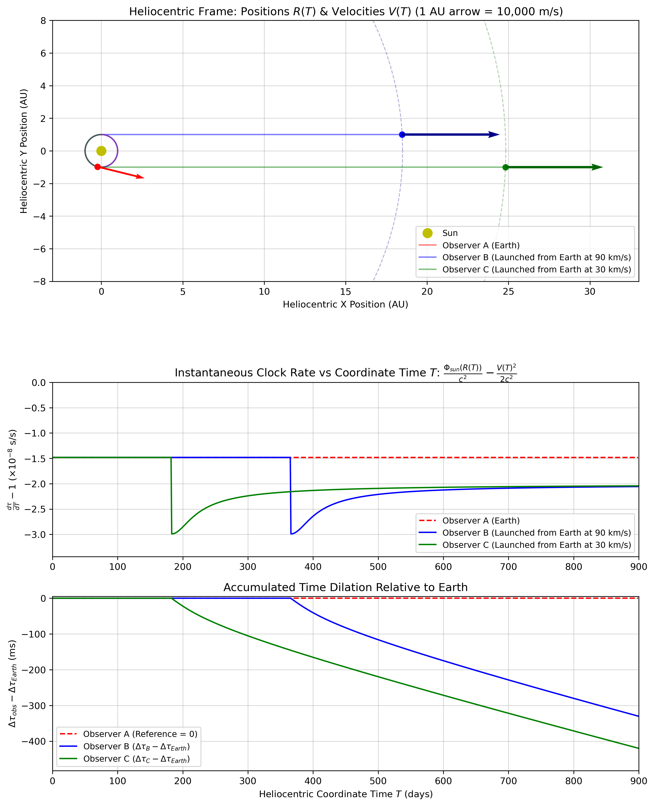
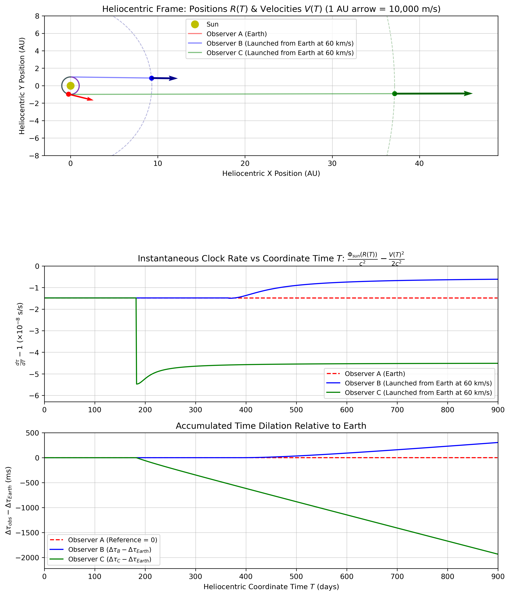
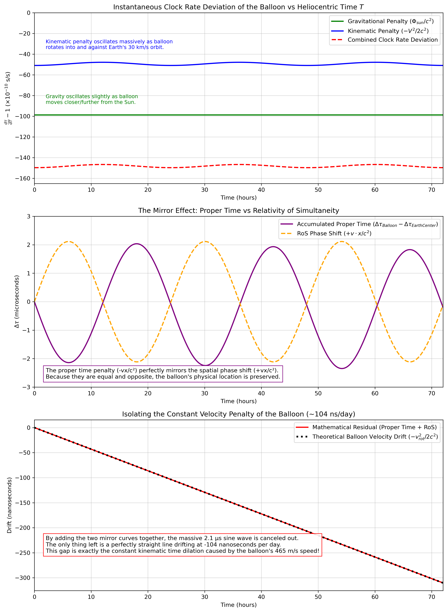

# The Classic Twin Paradox Perception
In the standard textbook formulation of the "Twin Paradox," time dilation is usually framed purely in terms of the velocity relative to Earth. To resolve the paradox, explaining why the traveling twin ages less rather than the other way around, the classic explanation relies on acceleration. We are taught that because only the traveling twin undergoes acceleration (departing, turning around, and stopping), the symmetry between the two observers is broken.

While this heuristic works for simple scenarios, it masks the true mechanics of relativity when launching from a platform that is already moving, such as the Earth orbiting the Sun. This simulation replaces the twin scenario with a Triplet Experiment to demonstrate why the classic focus on relative velocity and acceleration is incomplete.

# Triplet Experiment Simulation

This project simulates the kinematics and resulting relativistic effects of three observers (A, B, and C) traveling through the solar system. Moving beyond classical relative velocity comparisons, this simulation resolves the "Twin Paradox" by integrating the proper time ($\tau$) of each observer relative to a single, overarching reference frame: the solar system's heliocentric coordinate time ($T$).

## The Heliocentric Frame & Proper Time Integration
Instead of calculating time dilation purely based on relative velocities between the observers (which ignores the non-inertial nature of Earth as a launch platform), this model evaluates each observer's exact trajectory through the Sun's gravitational well. 

At every time step, the simulation calculates the fractional clock rate difference by combining:
1. **Gravitational Time Dilation:** $\frac{\Phi_{sun}(R(T))}{c^2}$ — Clocks tick slower deeper in the Sun's gravitational well.
2. **Kinematic Time Dilation:** $-\frac{V(T)^2}{2c^2}$ — Clocks tick slower the faster they move relative to the solar system's rest frame.

The total elapsed proper time ($\Delta\tau$) is the cumulative integral of these local Lorentz and gravitational transformations over the coordinate time $T$.

## Resolving the Twin Paradox: The Scenarios

A fundamental premise of this model is demonstrating how Earth's own orbital velocity ($\approx 30\text{ km/s}$) breaks the symmetry of the Twin Paradox. To illustrate this, the project provides two distinct scenarios:

### Scenario 1: Identical Heliocentric Velocities (30/90 km/s relative launches)
In this scenario, we want both traveling observers (B and C) to travel at exactly $60\text{ km/s}$ relative to the Sun.
* **Observer B** departs after 1 full orbit (when Earth is moving at $-30\text{ km/s}$ on the x-axis). To reach a heliocentric speed of $+60\text{ km/s}$, B must be launched at **$90\text{ km/s}$ relative to Earth**.
* **Observer C** departs after 0.5 orbits (when Earth is moving at $+30\text{ km/s}$ on the x-axis). To reach a heliocentric speed of $+60\text{ km/s}$, C only needs to be launched at **$30\text{ km/s}$ relative to Earth**.



### Scenario 2: Identical Relative Launch Velocities  (60/60 km/s relative to Earth)
In this complementary scenario, both observers are launched at exactly **$60\text{ km/s}$ relative to Earth**. 
* **Observer B (Downstream Launch):** Departs at $t=1$ year. Because Earth is moving at $-30\text{ km/s}$, Observer B's absolute heliocentric velocity is drastically reduced to **$30\text{ km/s}$**. B suffers the same kinematic penalty as Earth, but because B travels further from the Sun (reducing the gravitational penalty), B's clock actually ends up ticking *faster* than Earth's.
* **Observer C (Upstream Launch):** Departs at $t=0.5$ years. Because Earth is moving at $+30\text{ km/s}$ at this moment, the velocities add up vectorially. Observer C achieves an absolute heliocentric velocity of **$90\text{ km/s}$**, resulting in a massive kinematic time dilation spike.



## The Physics & Simulation Parameters

The simulation is set up with the following parameters:
* **The Sun** is stationary at the origin $(x=0, y=0)$.
* **Observer A (Earth)** starts at $x=0, y=1\text{ AU}$ and travels in a counter-clockwise circular orbit. Observer A serves as our baseline clock, experiencing a constant gravitational and kinematic time dilation penalty relative to the solar system.

### The Proper Time Calculation
For any point in space, an observer is at a heliocentric distance $R(T) = \sqrt{x(T)^2 + y(T)^2}$ with a heliocentric velocity $V(T) = \sqrt{v_x(T)^2 + v_y(T)^2}$.

The rate of proper time $\tau$ relative to coordinate time $T$ is:

$$
\frac{d\tau}{dT} = 1 + \frac{\Phi_{sun}(R(T))}{c^2} - \frac{V(T)^2}{2c^2}
$$

Where $\Phi_{sun}(R) = -\frac{G M_{sun}}{R}$. The script integrates this dynamically over the entire journey to find the exact accumulated time dilation relative to Earth ($\Delta\tau_{obs} - \Delta\tau_{Earth}$).


## The Equatorial Thought Experiment & The ECI Frame
To fully understand how local inertial frames govern time dilation, we can look at a classic thought experiment on Earth's equator involving two observers:
* **Observer A (The Plane):** Flies due West along the equator at approximately 465 m/s, matching the rotational speed of the Earth so that the Sun remains perfectly overhead.
* **Observer B (The Balloon):** Floats in a tethered balloon at the exact same altitude, simply rotating along with the Earth.

To evaluate their time dilation, we must use the **Earth-Centered Inertial (ECI) frame**. The ECI is a non-rotating reference frame that moves through space alongside the Earth. In this frame, the Earth rotates beneath the coordinate system. 

From the ECI perspective, the kinematic reality becomes clear: **Observer A** is completely stationary ($v_A \approx 0\text{ m/s}$), while **Observer B** in the balloon is hurtling eastward through space at $v_B \approx 465\text{ m/s}$. Because Observer A is at rest relative to the local inertial frame, A suffers no kinematic time dilation penalty. Observer B, however, is moving relative to the ECI and therefore experiences a constant time dilation penalty. After a 24-hour period, Observer A's clock will have advanced faster, leading Observer B's clock by approximately 104 nanoseconds. Time dilation is driven by speed relative to the local non-rotating inertial frame, not speed relative to the ground.

## The Heliocentric Contradiction & Its Resolution
When we shift our perspective from the regional ECI frame to the overarching Heliocentric frame, an apparent contradiction emerges regarding Observer B (the balloon):

* **In the ECI Frame:** The balloon travels at a constant, static speed of 465 m/s. Its kinematic time dilation is constant.
* **In the Heliocentric Frame:** The Earth is orbiting the Sun at $\sim 30\text{ km/s}$. As the Earth rotates, the balloon's absolute heliocentric velocity oscillates. On the midnight side, the balloon's rotational velocity adds to Earth's orbital velocity ($30\text{ km/s} + 465\text{ m/s}$). On the noon side, it subtracts ($30\text{ km/s} - 465\text{ m/s}$). 

If kinematic time dilation oscillates in the heliocentric frame, how can the balloon's clock rate remain constant relative to the center of the Earth? 

The resolution lies in General Relativity and the full proper time equation: $\frac{d\tau}{dT} = 1 + \frac{\Phi_{sun}}{c^2} - \frac{V^2}{2c^2}$.

First, we must account for the Sun's gravitational potential well ($\Phi_{sun}$). As the balloon rotates around the Earth, the kinematic and gravitational penalties perfectly counterbalance each other:
* **At Solar Noon:** The balloon is closest to the Sun. It experiences a *weaker* kinematic penalty (slower heliocentric speed) but a *stronger* gravitational penalty (deeper in the Sun's gravity well).
* **At Midnight:** The balloon is furthest from the Sun. It experiences a *stronger* kinematic penalty (faster heliocentric speed) but a *weaker* gravitational penalty (higher up in the Sun's gravity well).

### The Relativity of Simultaneity & Position Integrity
While the gradient of the Sun's gravity cancels out the *average* drift, the mathematical integral of these forces still leaves a massive daily oscillation of $\pm 2.1\text{ }\mu\text{s}$ in the accumulated proper time. 

Why doesn't this $2.1\text{ }\mu\text{s}$ time fluctuation result in a physical position difference (a spatial displacement) for the balloon? 

This oscillation is the exact manifestation of the **Relativity of Simultaneity** phase shift ($\frac{vx}{c^2}$) from the Lorentz transformation. With Earth's orbital velocity ($v \approx 30,000\text{ m/s}$) and radius ($x \approx 6,378,000\text{ m}$), the phase shift is exactly $\frac{(30,000)(6,378,000)}{c^2} \approx 2.1\text{ }\mu\text{s}$. 

This time oscillation is not a physical clock error; it is the exact coordinate offset required by spacetime geometry to guarantee that the physical spatial position of the balloon remains perfectly consistent whether viewed from the rotating ECI frame or the overarching Heliocentric frame.



## Real-World Application: The GPS Satellite Network
The exact principles modeled in this simulation—balancing kinematic and gravitational time dilation within the Earth-Centered Inertial (ECI) frame—are what allow the Global Positioning System (GPS) to function. 

If we place an observer (a GPS satellite) in orbit at an altitude of ~20,200 km, we must calculate its proper time relative to observers on the surface of the Earth. In the ECI frame, two competing relativistic effects occur:
1. **Gravitational Time Dilation:** Because the satellite is much further from Earth's center, it is higher up in Earth's gravitational well. Consequently, its atomic clocks tick *faster* than those on the ground by about **+45.9 microseconds per day**.
2. **Kinematic Time Dilation:** The satellite orbits the Earth at a speed of about 3.9 km/s relative to the non-rotating ECI frame. This speed causes its clocks to tick *slower* than stationary ground clocks by about **-7.1 microseconds per day**.

Combining these two effects yields a constant net drift: a GPS satellite's clock will naturally run **+38.6 microseconds per day faster** than a clock on Earth. Because light travels at roughly 300 meters per microsecond, a 38.6 $\mu$s error would result in a navigational position drift of over 11 kilometers in a single day!

**The Engineering Resolution:** 
To ensure that all GPS satellites have synchronized atomic clocks that do not require continuous mathematical correction in orbit, engineers apply a hardwired relativity adjustment *before launch*. A GPS atomic clock is designed to run at a base frequency of exactly 10.23 MHz on Earth. Before the satellite is put on the rocket, its oscillator is deliberately "detuned" (slowed down) to **10.22999999543 MHz**. Once the satellite reaches its operational orbit, the +38.6 $\mu$s/day relativistic speed-up perfectly compensates for this detuning, causing the orbiting clock to tick at exactly 10.23 MHz relative to receivers on the ground.

**Why the Sun Doesn't Break the GPS Network:**
As proven by our Equatorial Balloon experiment, the GPS network does not need to constantly adjust for the Earth's 30 km/s orbit around the Sun. Even though a GPS satellite's absolute heliocentric velocity oscillates massively as it orbits the Earth, the Earth is in free fall. The gradient of the Sun's gravity across the satellite's orbit perfectly cancels out the heliocentric kinematic oscillations (resulting in the Relativity of Simultaneity phase shift). This perfectly shields the local ECI frame, allowing GPS satellites to stay synchronized using only Earth's local gravity and velocity parameters.
## Activate the environment

* `conda env create -f environment.yml`
* `conda activate triplet-experiment`

## Run the simulations

### 1. The 30/90 Relative Launch Scenario (Constant 60 km/s Heliocentric)

Run the static plot generator:
```bash
python main_30_90.py
```
*Outputs: `accumulated_time_dilation_30_90.png`*

Run the animation generator:
```bash
python main_animated_30_90.py
```
*Outputs: `triplet_heliocentric_animation_30_90.mp4`*

### 2. The 60/60 Relative Launch Scenario (Variable Heliocentric)

Run the static plot generator:
```bash
python main_60_60.py
```
*Outputs: `accumulated_time_dilation_60_60.png`*

Run the animation generator:
```bash
python main_animated_60_60.py
```
*Outputs: `triplet_heliocentric_animation_60_60.mp4`*

Run the equatorial balloon (The Mirror Effect):
```bash
python equator_balloon_mirror.py
```
*Outputs: `equator_balloon.png`*